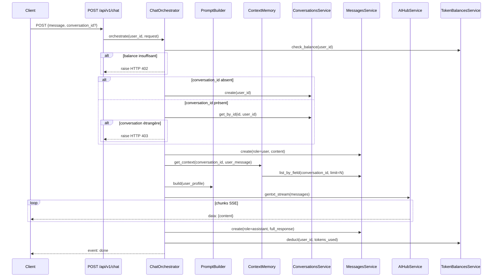

# Design Technique — SoulEcho Backend

## Vue d'ensemble

SoulEcho Backend est une API FastAPI qui orchestre des conversations empathiques assistées par IA. Ce document décrit l'architecture des nouveaux composants à greffer sur la stack existante (FastAPI + PostgreSQL + SQLAlchemy async + JWT + OpenAI SDK).

Les nouveaux composants s'articulent autour de trois axes :
1. **Chat orchestré** — un endpoint SSE unique qui coordonne conversation, mémoire contextuelle, prompt dynamique et déduction de tokens
2. **Profil utilisateur enrichi** — stockage du type de personnalité, contexte de vie et préférences de communication
3. **Suivi émotionnel** — enregistrement et analyse des scores de bien-être dans le temps

Tous les nouveaux composants réutilisent les services existants (`ConversationsService`, `MessagesService`, `Token_balancesService`, `AIHubService`) sans les réécrire.

---

## Architecture

### Vue d'ensemble des flux



### Structure des nouveaux fichiers

```
app/Backend/
├── models/
│   ├── user_profile.py          # Nouveau : UserProfile
│   └── emotional_score.py       # Nouveau : EmotionalScore
├── services/
│   ├── chat_orchestrator.py     # Nouveau : ChatOrchestrator
│   ├── prompt_builder.py        # Nouveau : PromptBuilder
│   ├── context_memory.py        # Nouveau : ContextMemory
│   └── emotional_tracker.py     # Nouveau : EmotionalTracker
├── routers/
│   ├── chat.py                  # Nouveau : /api/v1/chat
│   ├── profile.py               # Nouveau : /api/v1/profile
│   └── emotional_checkin.py     # Nouveau : /api/v1/emotional-checkin
├── schemas/
│   ├── chat.py                  # Nouveau : ChatRequest, ChatEvent
│   ├── profile.py               # Nouveau : UserProfileSchema
│   └── emotional_checkin.py     # Nouveau : EmotionalCheckinSchema, StatsSchema
└── alembic/versions/
    └── xxxx_add_soul_echo_tables.py  # Migration Alembic
```

---

## Composants et Interfaces

### ChatOrchestrator (`services/chat_orchestrator.py`)

Coordonne l'ensemble du flux de chat. Reçoit une session DB, instancie les services existants, et expose une méthode `stream()` qui retourne un `AsyncGenerator`.

```python
class ChatOrchestrator:
    def __init__(self, db: AsyncSession)
    async def stream(
        self,
        user_id: str,
        message: str,
        conversation_id: Optional[int],
    ) -> AsyncGenerator[dict, None]
    # Yields: {"type": "chunk"|"done"|"error", "content": str, "conversation_id": int}
```

Responsabilités internes :
- Vérification du solde tokens (HTTP 402 si insuffisant)
- Création ou vérification de la conversation (HTTP 403 si étrangère)
- Sauvegarde du message utilisateur
- Appel à `ContextMemory` et `PromptBuilder`
- Streaming via `AIHubService.gentxt_stream()`
- Sauvegarde de la réponse complète + déduction tokens
- Annulation de la déduction en cas d'erreur stream
- Journalisation RGPD (user_id, conversation_id, model, tokens — sans contenu)

### PromptBuilder (`services/prompt_builder.py`)

Construit le prompt système dynamique à partir d'un `UserProfile`.

```python
class PromptBuilder:
    MAX_PROMPT_TOKENS = 2000

    def build(self, profile: Optional[UserProfile]) -> str
    # Retourne le prompt système complet, tronqué à MAX_PROMPT_TOKENS si nécessaire

    def _estimate_tokens(self, text: str) -> int
    # Estimation simple : len(text) // 4
```

Logique de construction :
1. Langue (défaut : `fr`)
2. Instruction de base empathique + disclaimer professionnel de santé mentale
3. Bloc personnalité MBTI/DISC (si défini)
4. Bloc style de communication (`direct` / `narrative` / `socratic`)
5. Bloc objectifs (si définis)
6. Bloc contexte de vie (si défini)
7. Troncature si > 2000 tokens

### ContextMemory (`services/context_memory.py`)

Récupère et prépare la fenêtre de contexte pour l'IA.

```python
class ContextMemory:
    def __init__(self, db: AsyncSession)
    async def get_context(
        self,
        conversation_id: int,
        system_prompt: str,
        current_message: str,
    ) -> list[dict]
    # Retourne la liste de messages au format OpenAI
    # [{"role": "system", "content": ...}, {"role": "user"|"assistant", "content": ...}, ...]
```

Logique :
- Récupère les `CONTEXT_WINDOW_SIZE` derniers messages (configurable via `.env`, défaut 20)
- Trie chronologiquement (plus ancien → plus récent)
- Tronque les messages les plus anciens si la somme dépasse `MAX_CONTEXT_TOKENS` (configurable, défaut 4000)
- Conserve toujours au minimum le dernier message utilisateur
- Place le `system_prompt` en position 0

### EmotionalTracker (`services/emotional_tracker.py`)

CRUD + statistiques sur les `EmotionalScore`.

```python
class EmotionalTracker:
    def __init__(self, db: AsyncSession)
    async def create_checkin(self, user_id: str, score: int, note: Optional[str]) -> EmotionalScore
    async def list_checkins(
        self, user_id: str,
        from_date: Optional[datetime], to_date: Optional[datetime],
        limit: int = 365
    ) -> list[EmotionalScore]
    async def get_stats(self, user_id: str) -> EmotionalStats
    async def delete_all_for_user(self, user_id: str) -> int  # retourne le nombre supprimé
```

Calcul de tendance :
- `improving` si moyenne_7j > moyenne_30j + 0.5
- `declining` si moyenne_7j < moyenne_30j - 0.5
- `stable` sinon

### ProfileService (`services/profile_service.py`)

CRUD sur `UserProfile` + opérations RGPD.

```python
class ProfileService:
    def __init__(self, db: AsyncSession)
    async def get_or_create(self, user_id: str) -> UserProfile
    async def update(self, user_id: str, data: UserProfileUpdate) -> UserProfile
    async def delete_user_data(self, user_id: str) -> dict  # suppression en cascade atomique
    async def export_user_data(self, user_id: str) -> dict  # portabilité RGPD
```

### Routers

| Router | Méthode | Path | Description |
|--------|---------|------|-------------|
| `chat.py` | POST | `/api/v1/chat` | Stream SSE orchestré |
| `profile.py` | GET | `/api/v1/profile` | Récupérer le profil |
| `profile.py` | PUT | `/api/v1/profile` | Créer/mettre à jour le profil |
| `profile.py` | DELETE | `/api/v1/profile/me` | Suppression RGPD en cascade |
| `profile.py` | GET | `/api/v1/profile/export` | Export JSON RGPD |
| `emotional_checkin.py` | POST | `/api/v1/emotional-checkin` | Enregistrer un check-in |
| `emotional_checkin.py` | GET | `/api/v1/emotional-checkin` | Lister les check-ins |
| `emotional_checkin.py` | GET | `/api/v1/emotional-checkin/stats` | Statistiques émotionnelles |

---

## Modèles de données

### UserProfile

```python
class UserProfile(Base):
    __tablename__ = "user_profiles"

    id          = Column(Integer, primary_key=True, autoincrement=True)
    user_id     = Column(String(255), unique=True, nullable=False, index=True)
    # FK logique vers users.id (pas de FK physique pour éviter les contraintes de cascade complexes)

    personality_type         = Column(String(10), nullable=True)
    # Valeurs valides : 16 types MBTI (INTJ, ENFP, ...) ou D/I/S/C (DISC)

    life_context             = Column(String(500), nullable=True)
    goals                    = Column(JSON, nullable=True)
    # Stocké en JSON : liste de strings, max 5 éléments

    communication_preference = Column(String(20), nullable=True)
    # Valeurs valides : "direct" | "narrative" | "socratic"

    language                 = Column(String(5), nullable=True, default="fr")
    # Code ISO 639-1 : "fr", "en", etc.

    created_at               = Column(DateTime(timezone=True), server_default=func.now())
    updated_at               = Column(DateTime(timezone=True), onupdate=func.now())
```

### EmotionalScore

```python
class EmotionalScore(Base):
    __tablename__ = "emotional_scores"

    id         = Column(Integer, primary_key=True, autoincrement=True)
    user_id    = Column(String(255), nullable=False, index=True)
    score      = Column(Integer, nullable=False)
    # Contrainte applicative : 1 <= score <= 10

    note       = Column(String(200), nullable=True)
    created_at = Column(DateTime(timezone=True), server_default=func.now(), nullable=False)
```

### Migration Alembic

Une migration unique `add_soul_echo_tables` crée les deux tables `user_profiles` et `emotional_scores`. Elle est générée via `alembic revision --autogenerate -m "add_soul_echo_tables"` après ajout des modèles dans `alembic/env.py`.

### Schémas Pydantic

**ChatRequest**
```python
class ChatRequest(BaseModel):
    message: str
    conversation_id: Optional[int] = None
```

**UserProfileUpdate**
```python
class UserProfileUpdate(BaseModel):
    personality_type: Optional[str] = None
    life_context: Optional[str] = Field(None, max_length=500)
    goals: Optional[list[str]] = Field(None, max_items=5)
    communication_preference: Optional[Literal["direct", "narrative", "socratic"]] = None
    language: Optional[str] = Field(None, min_length=2, max_length=5)

    @validator("personality_type")
    def validate_personality_type(cls, v):
        MBTI = {"INTJ","INTP","ENTJ","ENTP","INFJ","INFP","ENFJ","ENFP",
                "ISTJ","ISFJ","ESTJ","ESFJ","ISTP","ISFP","ESTP","ESFP"}
        DISC = {"D","I","S","C"}
        if v and v.upper() not in MBTI | DISC:
            raise ValueError("personality_type must be a valid MBTI type or DISC value")
        return v.upper() if v else v
```

**EmotionalCheckinCreate**
```python
class EmotionalCheckinCreate(BaseModel):
    score: int = Field(..., ge=1, le=10)
    note: Optional[str] = Field(None, max_length=200)
```

**EmotionalStats**
```python
class EmotionalStats(BaseModel):
    avg_7d: Optional[float]
    avg_30d: Optional[float]
    min_30d: Optional[int]
    max_30d: Optional[int]
    trend: Literal["improving", "stable", "declining", "insufficient_data"]
```

---

## Propriétés de Correction

*Une propriété est une caractéristique ou un comportement qui doit être vrai pour toutes les exécutions valides d'un système — c'est essentiellement un énoncé formel de ce que le système doit faire. Les propriétés servent de pont entre les spécifications lisibles par l'humain et les garanties de correction vérifiables automatiquement.*

### Propriété 1 : Solde insuffisant bloque le chat

*Pour tout* utilisateur dont le solde de tokens est inférieur au coût estimé de la requête, l'appel à `ChatOrchestrator.stream()` doit lever une exception HTTP 402 avant tout appel à l'IA ou toute écriture en base.

**Valide : Requirements 1.8**

### Propriété 2 : Ownership de conversation

*Pour tout* `conversation_id` fourni qui n'appartient pas à l'utilisateur authentifié, `ChatOrchestrator.stream()` doit lever une exception HTTP 403 sans appeler l'IA.

**Valide : Requirements 1.3, 1.4**

### Propriété 3 : Persistance des deux messages après stream

*Pour tout* échange de chat complété avec succès, le message utilisateur (rôle `user`) et la réponse IA (rôle `assistant`) doivent tous deux être présents en base de données avec le bon `conversation_id` après la fin du stream.

**Valide : Requirements 1.5, 1.6**

### Propriété 4 : Déduction de tokens correcte

*Pour tout* échange de chat complété avec succès, le solde de tokens après l'échange doit être égal au solde avant moins exactement le nombre de tokens consommés (prompt + completion).

**Valide : Requirements 1.7**

### Propriété 5 : Annulation de la déduction en cas d'erreur stream

*Pour tout* échange de chat qui échoue pendant le stream IA, le solde de tokens de l'utilisateur doit être identique avant et après l'appel (aucune déduction nette).

**Valide : Requirements 1.10**

### Propriété 6 : Round-trip profil utilisateur

*Pour tout* `UserProfile` créé ou mis à jour avec des valeurs valides, la lecture immédiate via `ProfileService.get_or_create()` doit retourner exactement les mêmes valeurs de champs.

**Valide : Requirements 2.1, 2.2, 2.3**

### Propriété 7 : Validation du type de personnalité invalide

*Pour toute* chaîne de caractères fournie comme `personality_type` qui n'est ni un des 16 types MBTI ni une des 4 valeurs DISC (D/I/S/C), `ProfileService.update()` doit retourner une erreur HTTP 422.

**Valide : Requirements 2.4, 2.5**

### Propriété 8 : Initialisation automatique du profil

*Pour tout* nouvel utilisateur, `ProfileService.get_or_create()` doit toujours retourner un objet `UserProfile` non null (jamais une exception ou None), même si aucun profil n'existe encore.

**Valide : Requirements 2.6**

### Propriété 9 : Contenu du prompt reflète le profil

*Pour tout* `UserProfile` avec des champs définis (`personality_type`, `communication_preference`, `goals`, `life_context`, `language`), le prompt produit par `PromptBuilder.build()` doit contenir les instructions correspondant à chacun de ces champs.

**Valide : Requirements 3.1, 3.2, 3.3, 3.4, 3.5, 3.6, 3.7, 3.8**

### Propriété 10 : Disclaimer santé mentale toujours présent

*Pour tout* `UserProfile` (y compris `None` ou un profil vide), le prompt produit par `PromptBuilder.build()` doit toujours contenir une instruction interdisant à l'IA de se substituer à un professionnel de santé mentale.

**Valide : Requirements 3.9**

### Propriété 11 : Prompt système respecte la limite de tokens

*Pour tout* `UserProfile` (avec n'importe quelle combinaison de champs remplis, y compris des valeurs maximales), `PromptBuilder.build()` doit retourner un prompt dont l'estimation de tokens est ≤ 2000.

**Valide : Requirements 3.10**

### Propriété 12 : Structure et ordre du contexte

*Pour toute* conversation avec N messages historiques, `ContextMemory.get_context()` doit retourner une liste où : (a) le premier élément a le rôle `system`, (b) les messages historiques suivent dans l'ordre chronologique strict (du plus ancien au plus récent), (c) le nombre de messages historiques est au maximum `CONTEXT_WINDOW_SIZE`.

**Valide : Requirements 4.1, 4.2, 4.3**

### Propriété 13 : Tronquage du contexte préserve le dernier message utilisateur

*Pour toute* conversation dont la somme estimée des tokens des messages historiques dépasse `MAX_CONTEXT_TOKENS`, `ContextMemory.get_context()` doit toujours inclure le dernier message utilisateur dans la liste retournée, même si cela implique de supprimer tous les autres messages historiques.

**Valide : Requirements 4.4, 4.5**

### Propriété 14 : Round-trip score émotionnel

*Pour tout* score émotionnel valide (entier dans [1, 10]) créé via `EmotionalTracker.create_checkin()`, la lecture immédiate via `list_checkins()` doit retourner un enregistrement avec le même score, le même `user_id`, et un `created_at` non null en UTC.

**Valide : Requirements 5.1**

### Propriété 15 : Score hors intervalle rejeté

*Pour tout* entier `score` strictement inférieur à 1 ou strictement supérieur à 10, `EmotionalTracker.create_checkin()` doit lever une erreur de validation HTTP 422 sans créer d'enregistrement.

**Valide : Requirements 5.2**

### Propriété 16 : Filtrage et tri des check-ins

*Pour tout* intervalle de dates `[from_date, to_date]`, `EmotionalTracker.list_checkins()` doit retourner uniquement les scores dont `created_at` est dans l'intervalle, triés par ordre chronologique croissant, et au maximum 365 entrées.

**Valide : Requirements 5.3, 5.7**

### Propriété 17 : Calcul correct des statistiques émotionnelles

*Pour tout* ensemble de scores émotionnels d'un utilisateur, `EmotionalTracker.get_stats()` doit calculer : (a) `avg_7d` = moyenne arithmétique des scores des 7 derniers jours, (b) `avg_30d` = moyenne des 30 derniers jours, (c) `trend` = `improving` si avg_7d > avg_30d + 0.5, `declining` si avg_7d < avg_30d - 0.5, `stable` sinon.

**Valide : Requirements 5.4, 5.5**

### Propriété 18 : Suppression RGPD en cascade sans orphelins

*Pour tout* utilisateur ayant des données associées (UserProfile, EmotionalScores, Conversations, Messages), après `ProfileService.delete_user_data()`, aucun enregistrement portant le `user_id` de cet utilisateur ne doit subsister dans aucune des quatre tables concernées.

**Valide : Requirements 6.3**

### Propriété 19 : Export RGPD isolé par utilisateur

*Pour tout* utilisateur dans un système multi-utilisateurs, `ProfileService.export_user_data()` doit retourner uniquement les données appartenant à cet utilisateur — aucune donnée d'un autre utilisateur ne doit apparaître dans l'export.

**Valide : Requirements 6.5**

---

## Gestion des erreurs

| Situation | Code HTTP | Comportement |
|-----------|-----------|--------------|
| Solde tokens insuffisant | 402 | Avant tout appel IA, pas d'écriture en base |
| Conversation étrangère | 403 | Vérification ownership avant tout traitement |
| `personality_type` invalide | 422 | Validation Pydantic + message descriptif |
| `communication_preference` invalide | 422 | Validation Pydantic `Literal` |
| Score émotionnel hors [1,10] | 422 | Validation Pydantic `Field(ge=1, le=10)` |
| Erreur pendant le stream IA | SSE error event | Annulation déduction tokens, événement `{"type": "error"}` envoyé au client |
| Utilisateur non trouvé | 404 | Sur les endpoints profile/checkin |
| Erreur DB pendant suppression RGPD | 500 + rollback | Transaction atomique, rollback complet |

### Stratégie de rollback du stream

Le `ChatOrchestrator` utilise un flag `tokens_deducted` pour savoir si la déduction a eu lieu. En cas d'exception pendant ou après le stream, si `tokens_deducted=True`, il effectue un crédit compensatoire via `Token_balancesService`.

---

## Stratégie de tests

### Approche duale

Les tests sont organisés en deux catégories complémentaires :

- **Tests unitaires** : exemples concrets, cas limites, conditions d'erreur
- **Tests de propriétés** : propriétés universelles vérifiées sur des entrées générées aléatoirement (Hypothesis)

Les deux approches sont complémentaires : les tests unitaires capturent des bugs concrets sur des exemples précis, les tests de propriétés vérifient la correction générale sur un espace d'entrées large.

### Tests unitaires (exemples et cas limites)

- `test_chat_router.py` : flux SSE complet avec mocks (header `X-AI-Generated`, `conversation_id` dans la réponse)
- `test_prompt_builder.py` : exemples de prompts pour chaque combinaison MBTI/DISC × communication_preference
- `test_context_memory.py` : conversation vide, exactement N messages, dépassement MAX_CONTEXT_TOKENS
- `test_emotional_tracker.py` : aucun score, scores sur exactement 7j, scores sur exactement 30j
- `test_profile_service.py` : suppression en cascade — vérification que toutes les tables sont vidées, confirmation avec horodatage UTC

### Tests de propriétés (property-based testing)

Bibliothèque : **Hypothesis** (Python, `pip install hypothesis`)

Configuration : minimum 100 itérations par test via `@settings(max_examples=100)`.

Chaque test de propriété est annoté avec un commentaire de traçabilité :
`# Feature: soul-echo-backend, Property {N}: {texte de la propriété}`

| Test | Propriété | Stratégie Hypothesis |
|------|-----------|----------------------|
| `test_prop_balance_check` | P1 | `st.integers(min_value=0)` solde, `st.integers(min_value=1)` coût |
| `test_prop_ownership_check` | P2 | `st.text()` user_id, `st.integers()` conversation_id |
| `test_prop_messages_persisted` | P3 | `st.text(min_size=1)` message, `st.integers()` conversation_id |
| `test_prop_token_deduction` | P4 | `st.integers(min_value=1)` tokens consommés |
| `test_prop_stream_error_no_deduction` | P5 | `st.integers(min_value=1)` solde initial |
| `test_prop_profile_roundtrip` | P6 | `st.builds(UserProfileUpdate, ...)` avec champs valides |
| `test_prop_personality_type_invalid` | P7 | `st.text().filter(lambda s: s not in VALID_TYPES)` |
| `test_prop_profile_init` | P8 | `st.text(min_size=1)` user_id |
| `test_prop_prompt_content` | P9 | `st.builds(UserProfile, ...)` avec tous les champs optionnels |
| `test_prop_prompt_disclaimer` | P10 | `st.builds(UserProfile, ...)` y compris `None` |
| `test_prop_prompt_token_limit` | P11 | `st.builds(UserProfile, ...)` avec valeurs maximales |
| `test_prop_context_structure` | P12 | `st.lists(st.builds(Message, ...))` |
| `test_prop_context_preserves_last` | P13 | `st.lists(st.builds(Message, ...))` avec dépassement tokens |
| `test_prop_checkin_roundtrip` | P14 | `st.integers(min_value=1, max_value=10)` score |
| `test_prop_score_validation` | P15 | `st.integers().filter(lambda x: x < 1 or x > 10)` |
| `test_prop_checkin_filter_sort` | P16 | `st.lists(st.builds(EmotionalScore, ...))`, `st.datetimes()` |
| `test_prop_trend_calculation` | P17 | `st.lists(st.integers(min_value=1, max_value=10), min_size=1)` |
| `test_prop_checkin_limit` | P18 | `st.integers(min_value=366, max_value=1000)` nombre de scores |
| `test_prop_gdpr_cascade_delete` | P18 | `st.builds(User, ...)` avec données associées générées |
| `test_prop_gdpr_export_isolation` | P19 | `st.lists(st.builds(User, ...), min_size=2)` |
