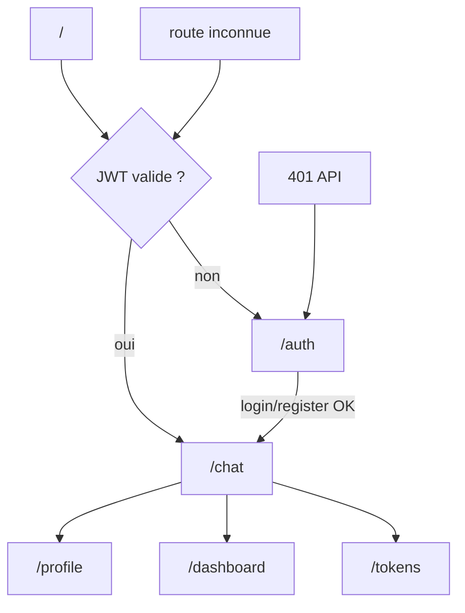
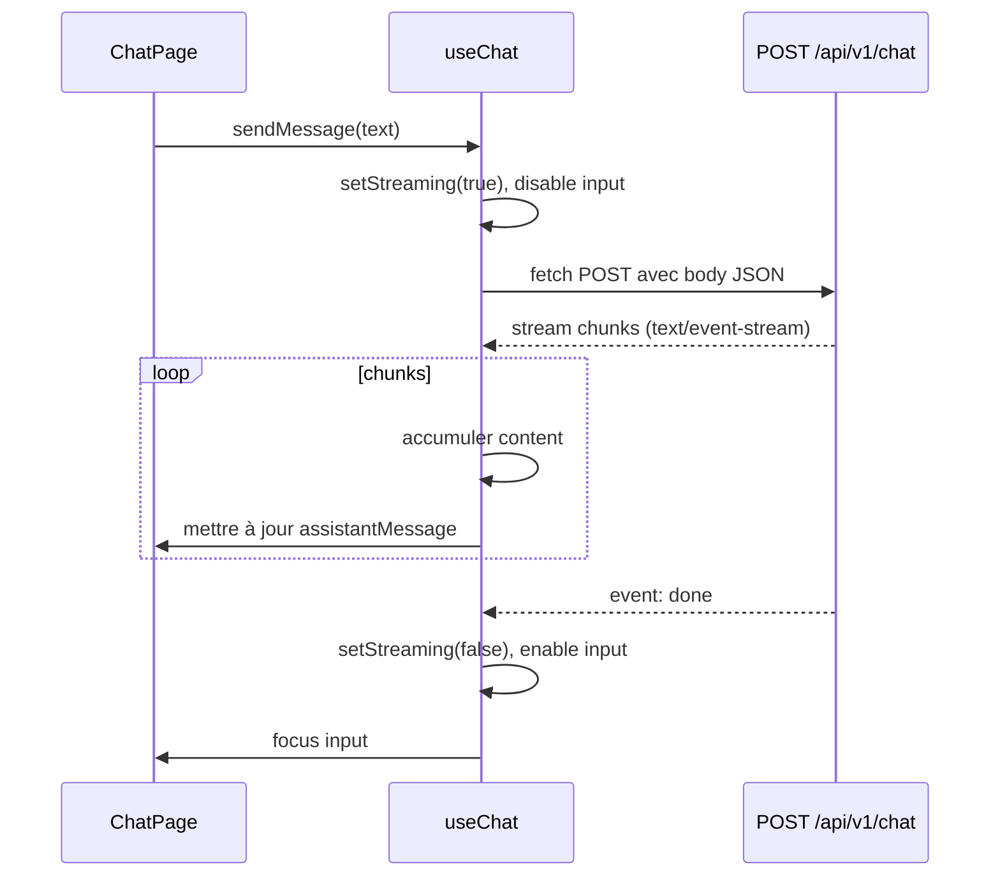

# Design Technique — SoulEcho Frontend

## Vue d'ensemble

SoulEcho Frontend est une Single Page Application React 18 / TypeScript construite avec Vite. Elle consomme l'API backend SoulEcho via Axios et gère l'authentification JWT. L'interface adopte un design sombre et apaisant (deep navy `#0D1B2A`, violet doux `#7C3AED`, blanc cassé `#F5F0EB`), minimaliste, avec des animations subtiles cohérentes avec la promesse de la marque.

Les cinq surfaces principales sont :
1. **Auth** — login / register avec validation Zod
2. **Chat** — interface immersive avec streaming SSE
3. **Profile** — gestion du profil enrichi (MBTI/DISC, objectifs, style de communication)
4. **Dashboard** — suivi émotionnel avec graphiques Recharts
5. **Tokens** — solde et achat de packages

### Décisions de conception clés

| Décision | Choix | Rationale |
|----------|-------|-----------|
| Streaming SSE | `fetch` + `ReadableStream` | Meilleur contrôle que `EventSource` (headers custom, POST) |
| État serveur | TanStack Query | Cache, invalidation, loading states automatiques |
| État local | `useState` + `useContext` | Suffisant pour auth token et UI state |
| Formulaires | react-hook-form + Zod | Validation déclarative, pas de logique manuelle |
| Routing | React Router v6 | Déjà installé, `createBrowserRouter` + `Outlet` |
| Notifications | sonner (toast) | Léger, compatible shadcn/ui |

---

## Architecture

### Arbre de composants

```
App
├── AuthProvider (context JWT)
│   └── QueryClientProvider
│       └── RouterProvider
│           ├── /auth → AuthPage
│           │   ├── LoginForm
│           │   └── RegisterForm
│           └── ProtectedLayout (Auth_Guard)
│               ├── AppShell
│               │   ├── Sidebar (navigation + token balance)
│               │   └── Outlet
│               ├── /chat → ChatPage
│               │   ├── ConversationSidebar
│               │   ├── MessageList
│               │   │   ├── MessageBubble (user)
│               │   │   └── MessageBubble (assistant) + StreamingCursor
│               │   └── ChatInput
│               ├── /profile → ProfilePage
│               │   ├── PersonalitySelector
│               │   ├── CommunicationStyleSelector
│               │   ├── GoalsTagInput
│               │   ├── LifeContextTextarea
│               │   └── GdprSection
│               ├── /dashboard → DashboardPage
│               │   ├── EmotionalChart (Recharts LineChart)
│               │   ├── StatsBlock
│               │   └── CheckinWidget
│               └── /tokens → TokensPage
│                   ├── BalanceCard
│                   └── PackageList
│                       └── PackageCard
```

### Flux de navigation



### Flux SSE (Chat)



---

## Composants et Interfaces

### Structure des fichiers

```
app/Frontend/src/
├── main.tsx                    # Entry point, QueryClient, RouterProvider
├── App.tsx                     # createBrowserRouter, routes
├── index.css                   # Variables CSS SoulEcho + Tailwind base
├── lib/
│   ├── api.ts                  # Axios instance + intercepteurs JWT
│   └── auth.ts                 # Helpers JWT (get/set/remove token)
├── hooks/
│   ├── useAuth.ts              # Context auth + login/logout/register
│   ├── useChat.ts              # Streaming SSE, messages, conversation_id
│   ├── useProfile.ts           # TanStack Query GET/PUT profil
│   ├── useDashboard.ts         # TanStack Query checkins + stats + POST checkin
│   └── useTokens.ts            # TanStack Query balances + packages + achat
├── pages/
│   ├── AuthPage.tsx
│   ├── ChatPage.tsx
│   ├── ProfilePage.tsx
│   ├── DashboardPage.tsx
│   └── TokensPage.tsx
├── components/
│   ├── layout/
│   │   ├── AppShell.tsx        # Layout avec sidebar
│   │   ├── Sidebar.tsx         # Navigation + token balance
│   │   └── ProtectedLayout.tsx # Auth_Guard + Outlet
│   ├── chat/
│   │   ├── MessageList.tsx
│   │   ├── MessageBubble.tsx
│   │   ├── StreamingCursor.tsx
│   │   └── ChatInput.tsx
│   ├── profile/
│   │   ├── PersonalitySelector.tsx
│   │   ├── CommunicationStyleSelector.tsx
│   │   ├── GoalsTagInput.tsx
│   │   └── GdprSection.tsx
│   ├── dashboard/
│   │   ├── EmotionalChart.tsx
│   │   ├── StatsBlock.tsx
│   │   └── CheckinWidget.tsx
│   └── tokens/
│       ├── BalanceCard.tsx
│       └── PackageCard.tsx
└── types/
    └── api.ts                  # Types TypeScript des entités API
```

### Interfaces des hooks principaux

```typescript
// useAuth
interface AuthContextValue {
  user: UserResponse | null
  isAuthenticated: boolean
  login: (email: string, password: string) => Promise<void>
  register: (email: string, password: string, name?: string) => Promise<void>
  logout: () => void
}

// useChat
interface UseChatReturn {
  messages: ChatMessage[]
  conversationId: number | null
  isStreaming: boolean
  sendMessage: (text: string) => Promise<void>
  loadConversation: (id: number) => Promise<void>
  resetConversation: () => void
}

// useProfile
interface UseProfileReturn {
  profile: UserProfileResponse | null
  isLoading: boolean
  updateProfile: (data: UserProfileUpdate) => Promise<void>
  exportData: () => Promise<void>
  deleteAccount: () => Promise<void>
}

// useDashboard
interface UseDashboardReturn {
  checkins: EmotionalCheckinResponse[]
  stats: EmotionalStats | null
  isLoading: boolean
  submitCheckin: (score: number, note?: string) => Promise<void>
}

// useTokens
interface UseTokensReturn {
  balance: TokenBalance | null
  packages: TokenPackage[]
  isLoading: boolean
  purchasePackage: (packageId: string) => Promise<void>
}
```

### API Client (`lib/api.ts`)

```typescript
// Axios instance avec intercepteurs
const api = axios.create({
  baseURL: import.meta.env.VITE_API_BASE_URL,
  headers: { 'Content-Type': 'application/json' },
})

// Request interceptor : injecte le JWT
api.interceptors.request.use((config) => {
  const token = getToken()
  if (token) config.headers.Authorization = `Bearer ${token}`
  return config
})

// Response interceptor : 401 → logout + redirect /auth
// Response interceptor : 5xx → toast erreur non intrusif
```

### Streaming SSE (`useChat.ts`)

Le streaming utilise `fetch` natif avec lecture du `ReadableStream` pour supporter les headers `Authorization` (non supportés par `EventSource`).

```typescript
const response = await fetch(`${baseURL}/api/v1/chat`, {
  method: 'POST',
  headers: {
    'Content-Type': 'application/json',
    Authorization: `Bearer ${getToken()}`,
  },
  body: JSON.stringify({ message, conversation_id: conversationId }),
})

const reader = response.body!.getReader()
const decoder = new TextDecoder()

while (true) {
  const { done, value } = await reader.read()
  if (done) break
  const text = decoder.decode(value)
  // Parser les lignes SSE : "data: {...}\n\n"
  // Accumuler content, détecter event: done, event: error
}
```

---

## Modèles de données (Types TypeScript)

```typescript
// src/types/api.ts

// Auth
export interface UserResponse {
  id: string
  email: string
  name?: string
  role: string
  last_login?: string
}

export interface TokenExchangeResponse {
  token: string
}

// Chat
export interface ChatRequest {
  message: string
  conversation_id?: number
}

export interface ChatEvent {
  type: 'chunk' | 'done' | 'error'
  content?: string
  conversation_id?: number
}

export interface ChatMessage {
  id: string           // uuid local
  role: 'user' | 'assistant'
  content: string
  isStreaming?: boolean
  createdAt: Date
}

// Profile
export type PersonalityType =
  | 'INTJ' | 'INTP' | 'ENTJ' | 'ENTP'
  | 'INFJ' | 'INFP' | 'ENFJ' | 'ENFP'
  | 'ISTJ' | 'ISFJ' | 'ESTJ' | 'ESFJ'
  | 'ISTP' | 'ISFP' | 'ESTP' | 'ESFP'
  | 'D' | 'I' | 'S' | 'C'

export type CommunicationPreference = 'direct' | 'narrative' | 'socratic'

export interface UserProfileResponse {
  id: number
  user_id: string
  personality_type?: PersonalityType
  life_context?: string
  goals?: string[]
  communication_preference?: CommunicationPreference
  language?: string
  created_at?: string
  updated_at?: string
}

export interface UserProfileUpdate {
  personality_type?: PersonalityType
  life_context?: string
  goals?: string[]
  communication_preference?: CommunicationPreference
  language?: string
}

// Emotional Check-in
export interface EmotionalCheckinCreate {
  score: number   // 1-10
  note?: string
}

export interface EmotionalCheckinResponse {
  id: number
  user_id: string
  score: number
  note?: string
  created_at: string
}

export interface EmotionalStats {
  avg_7d?: number
  avg_30d?: number
  min_30d?: number
  max_30d?: number
  trend: 'improving' | 'stable' | 'declining' | 'insufficient_data'
}

// Tokens
export interface TokenBalance {
  user_id: string
  balance: number
}

export interface TokenPackage {
  id: string
  name: string
  tokens: number
  price: number
  currency: string
}

// Conversations (sidebar)
export interface Conversation {
  id: number
  user_id: string
  title?: string
  created_at: string
  updated_at?: string
  first_message?: string
}
```

### Schémas Zod (validation formulaires)

```typescript
// Auth
const loginSchema = z.object({
  email: z.string().email('Email invalide'),
  password: z.string().min(8, 'Minimum 8 caractères'),
})

const registerSchema = loginSchema.extend({
  name: z.string().min(1).optional(),
})

// Profile
const profileSchema = z.object({
  personality_type: z.enum([...MBTI_TYPES, ...DISC_TYPES]).optional(),
  life_context: z.string().max(500).optional(),
  goals: z.array(z.string()).max(5).optional(),
  communication_preference: z.enum(['direct', 'narrative', 'socratic']).optional(),
  language: z.string().min(2).max(5).optional(),
})

// Check-in
const checkinSchema = z.object({
  score: z.number().int().min(1).max(10),
  note: z.string().max(200).optional(),
})
```

---

## Gestion d'état

### Stratégie globale

| Couche | Outil | Données |
|--------|-------|---------|
| Serveur (cache) | TanStack Query | Profile, checkins, stats, tokens, packages |
| Auth | React Context | JWT token, user info |
| UI local | useState | Streaming state, conversation_id, messages en cours |
| Formulaires | react-hook-form | Valeurs de formulaire, erreurs de validation |

### TanStack Query — clés de cache et stratégie

```typescript
// Query keys
const QUERY_KEYS = {
  profile: ['profile'],
  checkins: ['checkins'],
  checkinStats: ['checkin-stats'],
  tokenBalance: ['token-balance'],
  tokenPackages: ['token-packages'],
  conversations: ['conversations'],
  conversation: (id: number) => ['conversation', id],
}

// staleTime
profile: 30_000        // 30s (req. 7.3)
tokenBalance: 30_000   // 30s (req. 7.3)
checkins: 60_000       // 1min
checkinStats: 60_000   // 1min
tokenPackages: 300_000 // 5min (données peu changeantes)
```

### Invalidation après mutations

- Après `submitCheckin` → invalider `checkins` + `checkinStats`
- Après `purchasePackage` → invalider `tokenBalance`
- Après `updateProfile` → invalider `profile`
- Après `sendMessage` → invalider `tokenBalance` + `conversations`

---

## Routing

```typescript
// App.tsx
const router = createBrowserRouter([
  {
    path: '/auth',
    element: <AuthPage />,
  },
  {
    path: '/',
    element: <ProtectedLayout />,   // Auth_Guard
    children: [
      { index: true, element: <Navigate to="/chat" replace /> },
      { path: 'chat', element: <ChatPage /> },
      { path: 'profile', element: <ProfilePage /> },
      { path: 'dashboard', element: <DashboardPage /> },
      { path: 'tokens', element: <TokensPage /> },
      { path: '*', element: <Navigate to="/chat" replace /> },
    ],
  },
  {
    path: '*',
    element: <Navigate to="/" replace />,
  },
])
```

`ProtectedLayout` vérifie `isAuthenticated` depuis `AuthContext`. Si `false`, redirige vers `/auth`. Si l'utilisateur est authentifié et accède à `/auth`, redirige vers `/chat`.

---

## Thème visuel

### Variables CSS (`src/index.css`)

```css
:root {
  --color-navy: #0D1B2A;
  --color-violet: #7C3AED;
  --color-cream: #F5F0EB;
  --color-navy-light: #1A2D42;
  --color-violet-light: #9D5CF6;
  --color-muted: #6B7280;
}
```

### Configuration Tailwind (`tailwind.config.ts`)

```typescript
extend: {
  colors: {
    navy: { DEFAULT: '#0D1B2A', light: '#1A2D42' },
    violet: { DEFAULT: '#7C3AED', light: '#9D5CF6' },
    cream: '#F5F0EB',
  },
  fontFamily: {
    sans: ['Inter', 'system-ui', 'sans-serif'],
    display: ['Playfair Display', 'Georgia', 'serif'],
  },
  animation: {
    'cursor-blink': 'blink 1s step-end infinite',
    'fade-in': 'fadeIn 0.3s ease-in-out',
  },
}
```

---

## Gestion des erreurs

| Situation | Comportement |
|-----------|-------------|
| HTTP 401 sur requête authentifiée | Intercepteur Axios → supprime JWT → redirect `/auth` |
| HTTP 422 formulaire | Affichage erreurs sous les champs concernés (react-hook-form) |
| HTTP 4xx/5xx achat token | Toast erreur explicite, page reste ouverte |
| HTTP 5xx global | Toast non intrusif via intercepteur Axios (req. 7.2) |
| Erreur stream SSE | Message d'erreur inline, réactivation input |
| Route inconnue | Redirect `/chat` (auth) ou `/auth` (non-auth) |
| Réseau indisponible | TanStack Query retry + message d'erreur via `isError` |

---


## Propriétés de Correction

*Une propriété est une caractéristique ou un comportement qui doit être vrai pour toutes les exécutions valides d'un système — c'est essentiellement un énoncé formel de ce que le système doit faire. Les propriétés servent de pont entre les spécifications lisibles par l'humain et les garanties de correction vérifiables automatiquement.*

### Propriété 1 : Authentification réussie → JWT stocké + redirection

*Pour tout* couple (email valide, mot de passe ≥ 8 caractères), lorsque l'API retourne un token JWT en réponse à login ou register, le token doit être présent dans le localStorage et la navigation doit pointer vers `/chat`.

**Valide : Requirements 1.2, 1.3**

### Propriété 2 : Validation côté client rejette les inputs invalides

*Pour tout* email mal formé ou mot de passe de moins de 8 caractères, la validation Zod doit retourner une erreur et aucune requête réseau ne doit être émise.

**Valide : Requirements 1.5**

### Propriété 3 : Erreur d'auth préserve les champs du formulaire

*Pour toute* réponse d'erreur HTTP 401 ou 422 du serveur, les valeurs saisies dans les champs email et mot de passe doivent rester inchangées après l'affichage du message d'erreur.

**Valide : Requirements 1.4**

### Propriété 4 : Auth_Guard redirige les routes protégées

*Pour toute* route protégée (`/chat`, `/profile`, `/dashboard`, `/tokens`) accédée sans JWT valide dans le localStorage, le composant `ProtectedLayout` doit rediriger vers `/auth`.

**Valide : Requirements 1.7**

### Propriété 5 : Intercepteur JWT injecte le token sur toutes les requêtes

*Pour tout* token JWT présent dans le localStorage et toute requête Axios émise, l'en-tête `Authorization: Bearer {token}` doit être présent dans la requête. Si le serveur répond HTTP 401, le token doit être supprimé du localStorage.

**Valide : Requirements 1.9, 1.10**

### Propriété 6 : Message utilisateur apparaît immédiatement dans la liste

*Pour tout* texte de message non vide envoyé via `sendMessage`, le message doit apparaître dans la liste des messages avec le rôle `user` avant que la réponse de l'API ne soit reçue.

**Valide : Requirements 2.2**

### Propriété 7 : Accumulation correcte des chunks SSE

*Pour tout* stream SSE composé de N chunks de texte, le contenu final du message assistant doit être égal à la concaténation ordonnée de tous les chunks reçus avant l'événement `done`.

**Valide : Requirements 2.3**

### Propriété 8 : Input désactivé pendant le streaming, réactivé après

*Pour tout* état de streaming actif (`isStreaming=true`), la zone de saisie et le bouton d'envoi doivent être désactivés. Lorsque l'événement `done` est reçu, `isStreaming` doit passer à `false` et l'input doit être réactivé.

**Valide : Requirements 2.5, 2.6**

### Propriété 9 : conversation_id conservé après le premier échange

*Pour tout* premier message d'une nouvelle conversation, le `conversation_id` retourné dans l'événement SSE `done` doit être conservé en état local et réutilisé pour tous les messages suivants de la même session.

**Valide : Requirements 2.8**

### Propriété 10 : Formulaire de profil pré-rempli avec les données existantes

*Pour tout* `UserProfileResponse` retourné par l'API, les champs du formulaire de profil doivent être initialisés avec les valeurs correspondantes (personality_type, life_context, goals, communication_preference).

**Valide : Requirements 3.1**

### Propriété 11 : Limite de 5 objectifs respectée

*Pour toute* liste d'objectifs existante de longueur 5, tenter d'ajouter un sixième objectif doit être bloqué par la validation Zod et aucune requête PUT ne doit être émise.

**Valide : Requirements 3.5**

### Propriété 12 : Soumission du profil valide → requête PUT émise

*Pour tout* profil valide soumis via le formulaire (passant la validation Zod), une requête PUT vers `/api/v1/profile` doit être émise avec les données du formulaire.

**Valide : Requirements 3.6, 3.8**

### Propriété 13 : Données du graphique correspondent aux check-ins

*Pour tout* ensemble de `EmotionalCheckinResponse` retourné par l'API, les données passées au composant `EmotionalChart` (Recharts) doivent contenir exactement les mêmes scores et dates, dans l'ordre chronologique.

**Valide : Requirements 4.3**

### Propriété 14 : Couleur de tendance correspond à la valeur

*Pour toute* valeur de `trend` dans `EmotionalStats`, le composant `StatsBlock` doit afficher la couleur verte pour `improving`, rouge pour `declining`, et neutre pour `stable` ou `insufficient_data`.

**Valide : Requirements 4.4, 4.9, 4.10**

### Propriété 15 : Score de check-in hors intervalle rejeté côté client

*Pour tout* entier `score` strictement inférieur à 1 ou strictement supérieur à 10, la validation Zod du formulaire de check-in doit retourner une erreur et aucune requête POST ne doit être émise.

**Valide : Requirements 4.5**

### Propriété 16 : Alerte solde faible affichée si balance < 10

*Pour tout* `TokenBalance` dont le champ `balance` est strictement inférieur à 10, le composant `BalanceCard` doit afficher une alerte visuelle. Pour tout solde ≥ 10, aucune alerte ne doit être affichée.

**Valide : Requirements 5.4**

### Propriété 17 : Rendu complet de chaque package de tokens

*Pour tout* `TokenPackage` retourné par l'API, le composant `PackageCard` doit afficher le nom, le nombre de tokens, le prix et un bouton d'achat actif.

**Valide : Requirements 5.2**

### Propriété 18 : Solde de tokens visible dans la navigation

*Pour tout* `TokenBalance` chargé, la valeur `balance` doit être affichée dans le composant `Sidebar`, visible depuis toutes les pages protégées.

**Valide : Requirements 5.1, 5.5**

---

## Stratégie de tests

### Approche duale

Les tests sont organisés en deux catégories complémentaires :

- **Tests unitaires** : exemples concrets, cas limites, conditions d'erreur
- **Tests de propriétés** : propriétés universelles vérifiées sur des entrées générées aléatoirement (fast-check)

Les deux approches sont complémentaires : les tests unitaires capturent des bugs concrets sur des exemples précis, les tests de propriétés vérifient la correction générale sur un espace d'entrées large.

### Bibliothèque de property-based testing

**fast-check** (`npm install --save-dev fast-check`) — bibliothèque PBT TypeScript/JavaScript mature, compatible Vitest.

Configuration : minimum **100 itérations** par test via `{ numRuns: 100 }`.

Chaque test de propriété est annoté avec un commentaire de traçabilité :
`// Feature: soul-echo-frontend, Property {N}: {texte de la propriété}`

### Tests unitaires (exemples et cas limites)

- `auth.test.tsx` : rendu de `/auth` avec les deux formulaires, redirection utilisateur authentifié vers `/chat`, comportement logout
- `protected-layout.test.tsx` : redirection vers `/auth` sans JWT, accès autorisé avec JWT valide
- `chat.test.tsx` : état vide (message de bienvenue), affichage erreur SSE, réactivation input après erreur
- `profile.test.tsx` : rendu sélecteur MBTI/DISC (20 options), modale de confirmation suppression compte
- `dashboard.test.tsx` : état vide (message d'invitation), rendu page `/dashboard`
- `api.test.ts` : configuration baseURL depuis `VITE_API_BASE_URL`, staleTime ≥ 30s pour profil et tokens
- `gdpr.test.tsx` : présence bandeau RGPD au premier chargement, mention "Contenu généré par IA" dans le chat

### Tests de propriétés (property-based testing)

| Test | Propriété | Stratégie fast-check |
|------|-----------|----------------------|
| `prop-auth-validation.test.ts` | P2 | `fc.emailAddress()` invalides, `fc.string({ maxLength: 7 })` |
| `prop-auth-error-fields.test.ts` | P3 | `fc.constantFrom(401, 422)` status codes |
| `prop-auth-guard.test.ts` | P4 | `fc.constantFrom('/chat', '/profile', '/dashboard', '/tokens')` |
| `prop-axios-interceptor.test.ts` | P5 | `fc.string({ minLength: 10 })` tokens JWT |
| `prop-chat-message-display.test.ts` | P6 | `fc.string({ minLength: 1 })` messages |
| `prop-sse-accumulation.test.ts` | P7 | `fc.array(fc.string(), { minLength: 1 })` chunks |
| `prop-chat-input-state.test.ts` | P8 | `fc.boolean()` isStreaming state |
| `prop-conversation-id.test.ts` | P9 | `fc.integer({ min: 1 })` conversation_id |
| `prop-profile-prefill.test.ts` | P10 | `fc.record({ personality_type: fc.option(...), ... })` |
| `prop-goals-limit.test.ts` | P11 | `fc.array(fc.string(), { minLength: 5, maxLength: 5 })` |
| `prop-profile-submit.test.ts` | P12 | `fc.record(...)` profils valides |
| `prop-chart-data.test.ts` | P13 | `fc.array(fc.record({ score: fc.integer({min:1,max:10}), created_at: fc.date() }))` |
| `prop-trend-color.test.ts` | P14 | `fc.constantFrom('improving', 'stable', 'declining', 'insufficient_data')` |
| `prop-checkin-validation.test.ts` | P15 | `fc.integer().filter(x => x < 1 \|\| x > 10)` |
| `prop-balance-alert.test.ts` | P16 | `fc.integer({ min: 0 })` balance |
| `prop-package-render.test.ts` | P17 | `fc.record({ name: fc.string(), tokens: fc.integer({min:1}), price: fc.float({min:0}) })` |
| `prop-sidebar-balance.test.ts` | P18 | `fc.integer({ min: 0 })` balance |
